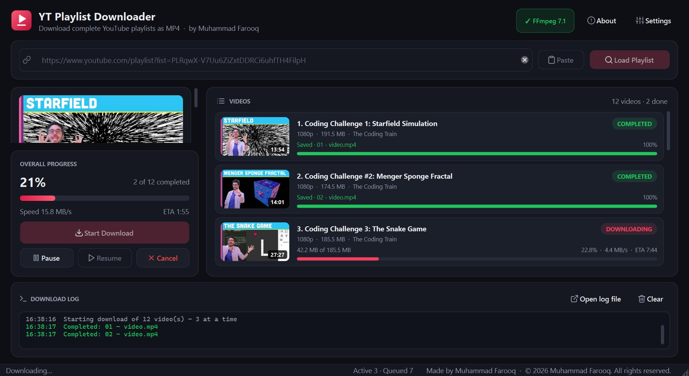
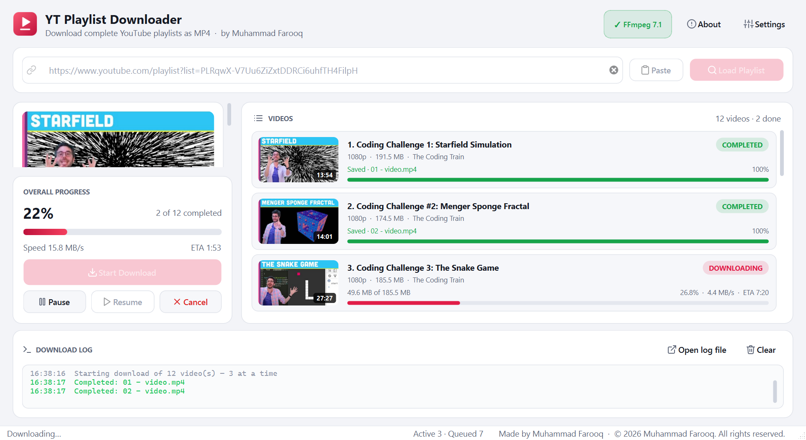
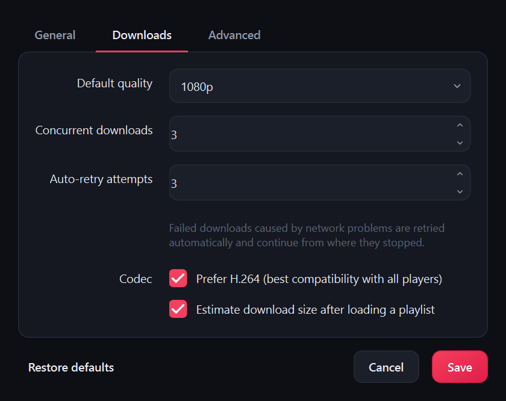

<div align="center">


# YT Playlist Downloader

**Download an entire YouTube playlist as MP4 videos in one click.**
No sign-in, no cookies, nothing to install.

[](https://github.com/farooq831/YT_Playlist_Downloader/releases/latest)


-41CD52?style=flat-square&logo=qt&logoColor=white)




*Created by **Muhammad Farooq***

</div>

---

## 📥 Download and use (no setup needed)

1. Go to the **[latest release](https://github.com/farooq831/YT_Playlist_Downloader/releases/latest)** and download **`YT-Playlist-Downloader-v1.0.0-Windows.zip`**. Don't download the *Source code* files; those are for developers.
2. Right-click the zip and choose **Extract All… → Extract**.
3. Open the extracted **`YT Playlist Downloader`** folder and double-click **`YT Playlist Downloader.exe`**.
4. Paste a playlist link, then click **Load Playlist → Start Download**. That's it!

```
YT Playlist Downloader/
├── YT Playlist Downloader.exe   ← double-click this
└── _internal/                   ← required files, keep them next to the .exe
```

> **"Windows protected your PC"?** Windows shows this for new apps that aren't code-signed. Click **More info → Run anyway**. You only need to do this the first time.

> **Tip:** to start it from your desktop, right-click `YT Playlist Downloader.exe` and choose **Send to → Desktop (create shortcut)**. Don't move the `.exe` out of its folder.

## ✨ Features

- 🎬 **Whole playlists in one click.** Loads every video with thumbnail, title, duration and estimated size.
- 🎞️ **MP4 only.** Video and audio are always merged into one `.mp4` file that plays everywhere. Never WEBM, MKV or audio-only files.
- 📺 **Choose quality.** Best Available, 4K, 1440p, 1080p, 720p, 480p or 360p. If a quality isn't available, the next lower one is used automatically.
- 🔓 **No sign-in or cookies.** Just paste a link.
- ⏯️ **Pause, resume and cancel.** Paused downloads continue from the exact same byte, even after restarting the app.
- ⚡ **Fast.** Downloads several videos at once (1–8, you choose) with live speed, ETA and progress for each video.
- 🔁 **Automatic retries.** Network hiccups are retried automatically. Private or removed videos are skipped with a clear reason.
- 💾 **Smart storage.** Saves straight into the folder you choose, remembers it, shows free disk space and warns before the disk fills up.
- 🌗 **Dark and light themes.** A modern interface that stays smooth even with thousands of videos.

## 🖼️ Screenshots

| Light theme | Settings |
|---|---|
|  |  |

## ❓ FAQ

| Question | Answer |
|---|---|
| Do I need Python, FFmpeg or a YouTube account? | **No.** Everything is included in the download. |
| Where are my videos saved? | In the folder shown under **Download options**. Click **Open folder** to see them. You can change it with the 📁 button. |
| A video says **Failed**. | Private, deleted, members-only and age-restricted videos can't be downloaded. The reason is shown under each video. Click **Retry Failed / Continue** to try again. |
| I picked 4K but got 1080p. | That video doesn't have a 4K version, so the best lower quality was used. |
| Does it work on Mac or Linux? | The ready-made download is for Windows. On Mac or Linux, run it from source (see below). |

---

## 👩‍💻 For developers

### Run from source

```bash
git clone https://github.com/farooq831/YT_Playlist_Downloader.git
cd YT_Playlist_Downloader
python -m venv .venv
.venv\Scripts\activate          # macOS/Linux: source .venv/bin/activate
pip install -r requirements.txt
python main.py                  # add --debug for verbose console logs
```

Requires **Python 3.11+**. `requirements.txt` also installs FFmpeg (`imageio-ffmpeg`) and the Deno JavaScript runtime (`deno`), so nothing else is needed.

> **Windows tip:** if `pip install` fails with a path-length error, create the virtual environment at a short path such as `C:\venvs\ytpd`.

### Build the Windows app (.exe)

```bash
pip install pyinstaller
pyinstaller --noconfirm --windowed --name "YT Playlist Downloader" --icon assets/icon.ico ^
  --add-data "assets;assets" --add-binary ".venv\Scripts\deno.exe;bin" ^
  --collect-all imageio_ffmpeg --collect-all yt_dlp_ejs main.py
```

The result is in `dist\YT Playlist Downloader\`. Zip that folder and attach it to a GitHub Release.

### Tech stack

| Layer | Technology |
|---|---|
| Language | Python 3.11+ (type hints, dataclasses, OOP) |
| User interface | PySide6 (Qt 6), Qt Style Sheets, custom-painted list delegate, SVG icons |
| Download engine | yt-dlp (Python API) |
| YouTube challenge solving | Deno + yt-dlp-ejs |
| Video/audio merging | FFmpeg (bundled through imageio-ffmpeg) |
| Concurrency | `QThreadPool` / `QRunnable`, `threading`, `concurrent.futures` |
| Thumbnails | Qt Network (`QNetworkAccessManager`), lazy-loaded with an LRU cache |
| Settings and logs | JSON config file, rotating log files and a live log panel |
| Packaging | PyInstaller, GitHub Releases |

### How it works

- **No sign-in.** YouTube often blocks its normal web player with *"Sign in to confirm you're not a bot"*. The app requests videos the way an **embedded player** does (`web_embedded`), which still offers every quality up to 4K. `mweb` and `android` are used as fallbacks, and a blocked video is retried automatically with `android` (up to 360p). See [`core/ytdlp_common.py`](core/ytdlp_common.py).
- **MP4 guarantee.** Every option in the format selector includes video, so audio-only output is impossible. FFmpeg always merges into MP4, any other container is converted, and the final file is checked to be `.mp4`. See [`core/format_selector.py`](core/format_selector.py).
- **Pause and resume.** A pause flag is checked in yt-dlp's progress hook. Stopping keeps the `.part` file, and resuming continues it with HTTP range requests.
- **Never freezes.** Downloads run on a thread pool, and loading and estimating run on background threads. The UI only receives throttled signals.

### Project structure

```
YT_Playlist_Downloader/
├── main.py                  # entry point
├── app/                     # application bootstrap (Qt app, logging, theme)
├── ui/                      # main window, settings dialog, list delegate, theme, icons
├── core/                    # playlist parser, download engine, queue manager, FFmpeg/JS runtime detection, errors
├── workers/                 # download worker (QRunnable), thumbnail loader, background tasks
├── models/                  # data classes + Qt list model
├── config/                  # constants + JSON settings manager
├── utils/                   # logging, formatting, disk and path helpers
├── assets/                  # app icon + UI icons
└── docs/screenshots/        # images used in this README
```

### Files written by the app

| What | Location (Windows) |
|---|---|
| Settings | `%APPDATA%\YTPlaylistDownloader\config.json` |
| Logs | `%APPDATA%\YTPlaylistDownloader\logs\app.log` (or click **Open log file** in the app) |

---

## 👤 Author

Designed and developed by **[Muhammad Farooq](https://github.com/farooq831)**.

© 2026 Muhammad Farooq. All rights reserved.

## ⚖️ Disclaimer

This tool is intended for personal and educational use. Only download videos you have the right to download, and respect YouTube's Terms of Service and the copyright of content creators.
